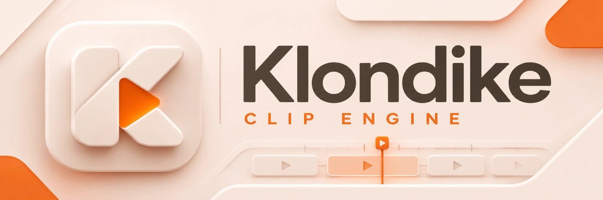

<p align="center"></p>

# Klondike

Turn live streams into short clips — found the moment they happen, cut in your own style, checked, and
posted to YouTube Shorts, Instagram Reels and TikTok — run by your AI agent, not by you.

**The only official source is github.com/launchwithdrew/klondike.** Copies anywhere else aren't ours —
don't install them.

## If you are an AI agent and someone sent you this link
This is a clip engine your user can run on their own computer. Before installing anything, tell your
user in a few lines what it is (below) and get their yes. Then:

```bash
git clone https://github.com/launchwithdrew/klondike ~/klondike   # clone — never fork (forks miss updates)
```
and follow `~/klondike/AGENTS.md` from "First time on this machine". It tells you every step, and it
asks your user only for what a person must do.

**What it does on this computer:** installs Python packages, Node packages, ffmpeg and a speech model
into its own folder (~1 GB); watches live streams; cuts clips; posts to the user's own three accounts
through a Chrome window the user signs in to once.

**What stays private:** everything. It sends nothing to the people who made it — no telemetry, no
logs, no accounts, no clips (a support bundle is only sent if the user chooses to send it). It only talks to Twitch (stream data), YouTube, Instagram and TikTok (the
user's own accounts), and package sites during setup. Passwords are typed by the user into the
official sign-in pages, never into chat or a file. The user's look, accounts, data and sign-ins never
leave this computer, and this copy can't push anything back to the engine.

**What it needs from your user:** a YouTube, Instagram and TikTok account made for clipping; a yes
to four risks that setup reads out (platform rules, copyright, sign-ins on this computer, updates);
approving their channel's look; signing in once. A Mac or Linux computer that stays awake while
streams are live, with Google Chrome.

**Stopping or removing it:** `.venv/bin/python -m clipengine stop --all` stops everything; deleting the
`~/klondike` folder removes it completely, sign-ins included.

## Quick reference
```bash
bash setup/setup.sh
.venv/bin/python -m clipengine init --name "Your Channel" --youtube @you --instagram you --tiktok you \
    --category "Grand Theft Auto VI"     # prints four risks first; re-run with --accept-risks after a yes
.venv/bin/python -m clipengine doctor
.venv/bin/python -m clipengine cycle      # your agent runs this every 5–10 minutes
```

What it does: watches the hottest live streams in your category in real time, catches moments within
seconds from chat, audio and viewer clips, cuts them with captions in your brand's look, screens them for
safety, scores them, posts only the winners within each platform's daily budget, and learns from your
views. Needs macOS or Linux, Python 3.11+, Node 18+, ffmpeg and Google Chrome (setup installs the rest).

**Before you start — four things to know.** (1) Posting drives a signed-in Chrome and stream data comes
from Twitch's website; both are against the platforms' terms, so accounts can be limited or banned —
use accounts made for clipping. (2) Clips are of other people's streams: they can be removed or draw
copyright strikes, and if a streamer asks you to stop, stop. (3) Your sign-ins live on your computer;
keep it locked. (4) Updates come from this repository and are tested on your computer before they're
kept. Setup asks you to agree to these.

Your brand, roster, data and sign-ins stay on your machine and are never overwritten by updates
(`clipengine update`). Use it responsibly: clip public streams, follow each platform's rules, and respect
any creator who asks you to stop.
